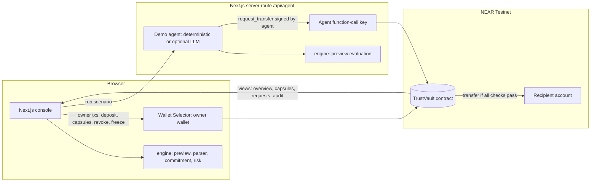
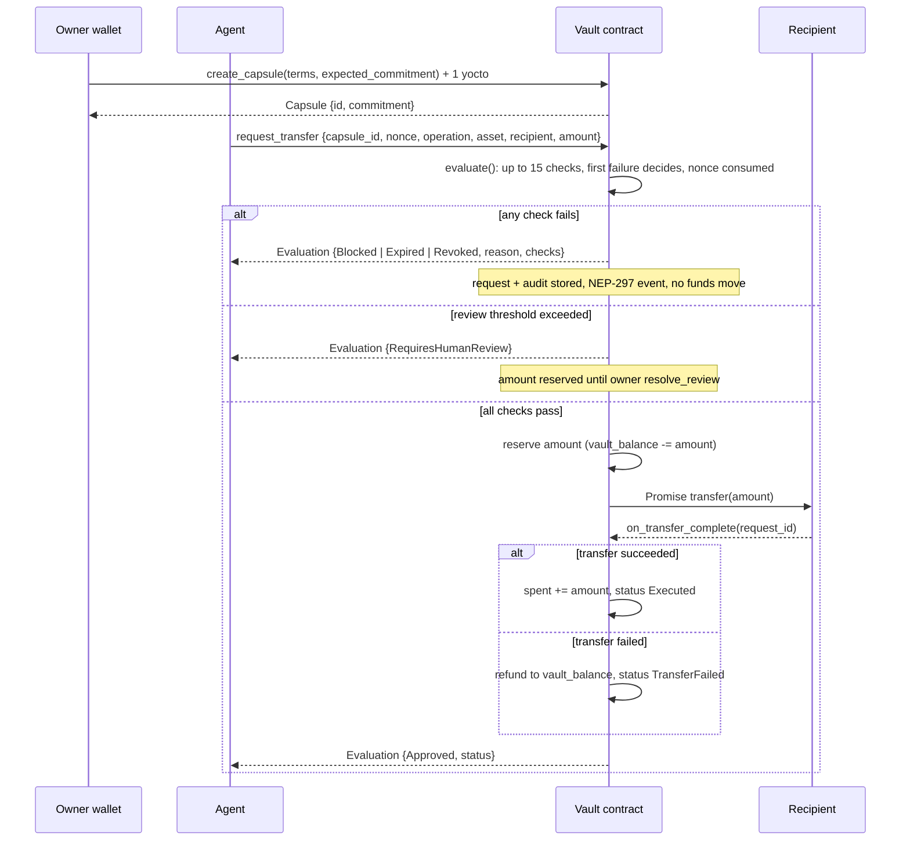

# Architecture

## Components

The contract is the only component that can release funds. Everything else either asks it to (owner, agent) or reads it (UI).

## Request lifecycle

## Contract state

| Field | Purpose |
| --- | --- |
| `owner`, `frozen` | Single owner per deployment; emergency freeze flag |
| `vault_balance` | Deposited NEAR not reserved, spent or withdrawn (internal ledger, independent of storage staking) |
| `total_reserved` | NEAR reserved for settling transfers and held reviews |
| `agents: IterableMap<AccountId, Agent>` | Status (Active/Suspended/Revoked), counters, capsule ids |
| `capsules: LookupMap<u64, Capsule>` | Terms, commitment, spent, reserved, last nonce, status |
| `requests: LookupMap<u64, RequestRecord>` | Every agent request with decision and reason; finalized records older than the newest 500 are pruned |
| `audit: LookupMap<u64, AuditEvent>` | Ring buffer of the last 500 audit events |

## Off-chain parity

`packages/engine/src/verify.ts` mirrors `evaluate()` in the contract: same check names, order and decision mapping, with matching explanation wording. Decisions and reason codes are covered by tests; the exact explanation wording is not. It powers previews and the Attack Lab's simulation mode. The commitment format is pinned by a shared test vector asserted in both `packages/engine/test/commitment.test.ts` and `contracts/sentinel-vault/src/tests.rs`.

## Why not a backend policy check?

A backend that approves transactions only protects agents that choose to ask it. TrustVault's agent never has custody: the funds are in the contract, so the checks cannot be skipped.
